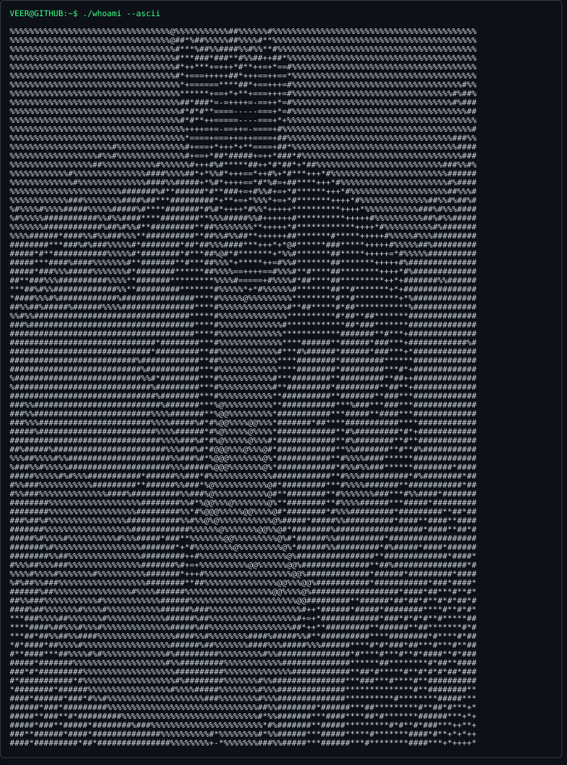
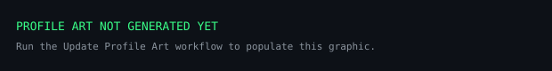
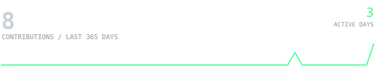
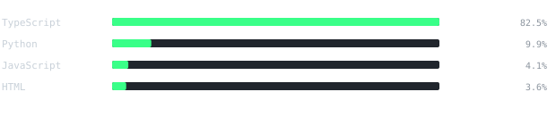

<div align="center">



<br/>

<sub>SOFTWARE ENGINEERING · AI · AUTOMATION · CLOUD</sub>

<br/><br/>

<a href="https://github.com/Veer-J-Kamdar">
  
</a>
<a href="https://www.linkedin.com/in/veer-j-kamdar-h1797/">
  
</a>
<a href="mailto:veer.business1797@gmail.com">
  
</a>

</div>

---


I'm a software engineer interested in building **mobile applications, AI-powered tools, automation systems, and reliable backend services**.

I enjoy taking ideas from prototype to implementation—building user-facing experiences, integrating intelligent workflows, and exploring cloud infrastructure and DevOps.

```text
FOCUS     React Native · TypeScript · AI · Automation · Cloud & DevOps
BUILDING  Useful products, dependable services, smarter workflows
APPROACH  Build small. Measure honestly. Automate what repeats.
```

---


### 01 / Samvaad

**Inclusive communication · Accessibility · AI**

An accessibility-focused communication platform exploring speech processing, text conversion, Braille, and sign-language technology.

[Mobile client →](https://github.com/veerkam1797/samvaad-mobile-client)

### 02 / IT Incident Agent

**AI agents · IT operations · Workflow automation**

An automation project focused on streamlining IT incident workflows, including user follow-ups and ticket-resolution processes.

[Explore repository →](https://github.com/veerkam1797/it-incident-agent)

---



<div align="center">


<br/><br/>

<code>Mobile</code> / <code>Backend</code> / <code>AI & Automation</code> / <code>Cloud & DevOps</code>

</div>

---


<div align="center">
  
  <br/><br/>
  
  <br/>
  
  <br/>
  
</div>

---


- Building mobile experiences with React Native and TypeScript.
- Exploring AI-assisted workflows, agents, and practical automation.
- Strengthening cloud, infrastructure, and DevOps skills.
- Turning useful ideas into maintainable software.

<div align="center">

<sub>Profile artwork and statistics are generated by this repository's GitHub Actions workflow.</sub>

<br/>

<sub>Built with curiosity. Improved continuously.</sub>

</div>
